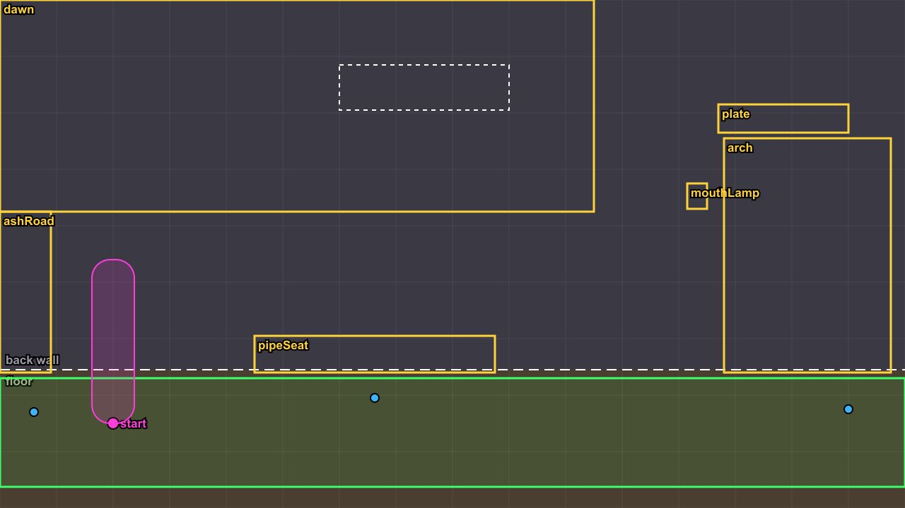

# Replacing the art

<!-- Generated by `npm run art:guide` from the game's data. Edit scripts/art-guide.ts, not this file. -->

Every image the game loads, what it must contain and where things go in it. Replace a file in `art/src/` with a new one that follows these rules and the game picks it up. Nothing in the code depends on how an image was made.

## Workflow

All new art follows the style bible, [art/STYLE.md](STYLE.md) (palette, scale, light, formats), and every image is listed in the art manifest (`art/manifest.mjs`).

1. `npm run art:briefs` writes a Codex brief per image in `art/briefs/` (start with [the pilot pack](briefs/PILOT.md)).
2. Give the brief and its attachments to Codex; put what it delivers in `art/inbox/` under the name the brief gives.
3. `npm run art:import` fits it to size, snaps it to the master palette, outlines sprites, re-cuts walk-behind pieces from rooms, writes the WebP copies and a before/after preview (`art/inbox/preview/`), and marks it final (`art/status.json`).
4. `npm run art:check`, then look at it in the game (`npm run dev`), then `npm run check` and `npm run e2e`.

Final art is safe: the generator scripts (`npm run art`) only make placeholders and skip anything final. Characters come as layers and need their joints measured once in the manifest (`RIGS`) before `npm run rig`.

## Conventions

- The world is 640×360 units; **all art is drawn at 2×** (rooms are 1280×720). Coordinates below are in art pixels, from the top left of the room image.
- PNG with transparency (8-bit palette or full colour). Pixel-art style, but any style works as long as sizes and anchors hold.
- Characters and objects are **anchored at the bottom centre**: the point that touches the floor. A character's feet stand on the bottom row of the frame, centred horizontally.
- Characters face **right** in side views; the game mirrors them for left. There is one view per direction tag (down, side, up); the same drawing may be reused.
- The game scales characters with depth (smaller further back) and tints them with the room's light, so draw them evenly lit.

## Rooms

Each room is one painting, 1280×720, in `art/src/rooms/`. The reference image next to it shows what the code expects:

- green: the floor Mara and the others can walk on; red: obstacles on the floor
- yellow: clickable things (purple: hidden secrets) with their ids; blue dots: where Mara stands to use them
- pink: where Mara enters the room; orange crosses: objects drawn over the room (their foot point); white dots: story characters' feet; small green dots: background people's stations
- cyan dashed: walk-behind pieces (see below); white dashed: the hanging name board

A new painting should put the things on the list where the reference image shows them, or the positions in `src/chapters/<chapter>/rooms.ts` must be moved to match the new painting (hotspot polygons, `walkTo`, the walk area, entries, objects, foreground pieces, `look` effects, crowd stations in `src/chapters/<chapter>/crowd.ts`). `npm test` checks that the walk area, approach points and stations stay consistent.

After a new painting, run `npm run art:outlines` (needs Python 3 with `opencv-python-headless` and `numpy`): it cuts the silhouette of every clickable thing painted into the room for the hover highlight (`art/src/outlines/`). Check `art/inbox/preview/outlines-<room>.png`; where a cut misses, trace a rough hint in `art/outlines.json` and run it again. `npm run art:check` warns about any painted hotspot without an outline.

### Mara's Tent: `rooms/tent.png`

| Clickable | Name | Box (x, y, w×h) | Mara stands at |
| --- | --- | --- | --- |
| `notebook` | mother's notebook | 80, 368, 76×28 | (120, 556) |
| `rack` | charging rack | 292, 256, 104×140 | (344, 556) |
| `jar` | water jar | 208, 336, 52×60 | (236, 556) |
| `workbench` | workbench | 28, 248, 356×256 | (220, 556) |
| `stool` | stool | 176, 456, 104×96 | — |
| `drum` | old brush drum | 484, 388, 188×132 | (580, 556) |
| `stove` | clay stove | 732, 412, 76×96 | (770, 556) |
| `tentFlap` | tent flap | 1132, 168, 148×372 | (1212, 568) |

- Object `objects/rack` (112×72, tags full (1), empty (1)): foot point (344, 394). Drawn on top of the room, so the painting should leave that spot free (or show what is behind it).
- Object `objects/notebook` (72×24, tags idle (1)): foot point (116, 394). Drawn on top of the room, so the painting should leave that spot free (or show what is behind it).
- Walk-behind piece `foreground/tent-stool.png` (108×96, top left at (176, 460)): the same pixels as the room painting there, transparent elsewhere. It is drawn in front of anyone standing behind it. Cut it from the new painting.
- The name board hangs from (240, 28) (about 184×64); it is painted by the game, so leave a quiet patch of wall there.
- Heat shimmer (High quality) over: 624, 60, 48×60: hot spots in the painting (fires, lamps, pipes).
- Flickering light pools at (1212, 380), (644, 104): lamps, kiln mouths, hearths in the painting.

### The Kiln Hall: `rooms/mara-room.png`

| Clickable | Name | Box (x, y, w×h) | Mara stands at |
| --- | --- | --- | --- |
| `tally` (secret) | scratches on the pillar | 16, 300, 80×140 | (80, 560) |
| `toTent` | Mara's tent | 408, 300, 184×224 | (500, 560) |
| `niche` | kiln mouths | 640, 240, 360×240 | (820, 560) |
| `pulleys` | pulley hoist | 148, 40, 104×340 | (200, 560) |
| `jars` | storage jars | 280, 428, 100×96 | (330, 560) |
| `cart` | ash cart | 1008, 436, 120×88 | (1068, 564) |
| `roomCurtain` | way to the firing house | 1184, 208, 96×320 | (1232, 580) |

- Object `objects/tent` (184×224, tags idle (1)): foot point (500, 528). Drawn on top of the room, so the painting should leave that spot free (or show what is behind it).
- Walk-behind piece `foreground/hall-left.png` (178×104, top left at (0, 616)): the same pixels as the room painting there, transparent elsewhere. It is drawn in front of anyone standing behind it. Cut it from the new painting.
- Walk-behind piece `foreground/hall-right.png` (166×92, top left at (1114, 628)): the same pixels as the room painting there, transparent elsewhere. It is drawn in front of anyone standing behind it. Cut it from the new painting.
- Walk-behind piece `foreground/hall-crate.png` (68×58, top left at (196, 622)): the same pixels as the room painting there, transparent elsewhere. It is drawn in front of anyone standing behind it. Cut it from the new painting.
- Animated prop `props/pulley.png` (swing) at (200, 120): hung from its top edge at that point; it swings.
- The name board hangs from (300, 96) (about 200×72); it is painted by the game, so leave a quiet patch of wall there.
- Heat shimmer (High quality) over: 640, 300, 360×160: hot spots in the painting (fires, lamps, pipes).
- Flickering light pools at (700, 400), (820, 392), (940, 400): lamps, kiln mouths, hearths in the painting.

### The Firing House: `rooms/firing-house.png`

| Clickable | Name | Box (x, y, w×h) | Mara stands at |
| --- | --- | --- | --- |
| `chalk` (secret) | chalk marks | 320, 290, 64×48 | (380, 560) |
| `sign` (secret) | old wooden sign | 452, 88, 68×76 | — |
| `pantryDoor` | Nell's pantry door | 608, 220, 120×304 | (668, 560) |
| `soup` | soup pot | 164, 352, 88×52 | (220, 560) |
| `shoes` | shoe racks | 68, 60, 240×220 | — |
| `hearth` | hearth | 112, 340, 184×184 | — |
| `stairs` | stairs to the gallery | 820, 192, 312×332 | (900, 568) |
| `kilnGate` | kiln gate | 1172, 192, 108×336 | (1232, 580) |
| `toRoom` | way to Mara's room | 0, 208, 60×320 | (48, 580) |

- Object `objects/pantry-door` (240×304, tags stuck (1), fixed (1)): foot point (668, 524). Drawn on top of the room, so the painting should leave that spot free (or show what is behind it).
- Nell stands at (500, 600).
- The name board hangs from (960, 100) (about 224×68); it is painted by the game, so leave a quiet patch of wall there.
- Heat shimmer (High quality) over: 120, 320, 180×140: hot spots in the painting (fires, lamps, pipes).
- Flickering light pools at (204, 460), (1224, 360): lamps, kiln mouths, hearths in the painting.

### Regulator Gallery: `rooms/gallery.png`

| Clickable | Name | Box (x, y, w×h) | Mara stands at |
| --- | --- | --- | --- |
| `railNames` (secret) | scratched railing | 720, 412, 92×100 | (768, 564) |
| `gauge` | pressure gauge | 424, 32, 88×88 | — |
| `regulator` | regulator | 320, 128, 320×380 | (480, 564) |
| `logbook` | Oren's logbook | 116, 416, 148×108 | — |
| `lantern` | lantern | 28, 280, 68×120 | — |
| `galleryStairs` | way to the firing house | 1172, 208, 108×320 | (1224, 584) |

- Object `objects/socket` (320×160, tags installed (1), removed (1)): foot point (480, 460). Drawn on top of the room, so the painting should leave that spot free (or show what is behind it).
- Animated prop `props/gauge-face.png` (gauge) at (468, 76): a needle-less dial (the game draws the needle), centred there.
- Oren stands at (960, 592).
- The name board hangs from (1040, 120) (about 148×120); it is painted by the game, so leave a quiet patch of wall there.
- Heat shimmer (High quality) over: 400, 0, 160×120: hot spots in the painting (fires, lamps, pipes).
- Flickering light pools at (62, 336), (468, 80): lamps, kiln mouths, hearths in the painting.

### The Ashways: `rooms/ashways.png`

| Clickable | Name | Box (x, y, w×h) | Mara stands at |
| --- | --- | --- | --- |
| `sweeper` | ash sweeper | 940, 456, 260×140 | — |
| `sweeperAtPipe` | ash sweeper | 260, 456, 260×140 | — |
| `valve` | steam valve | 180, 320, 112×204 | (300, 564) |
| `passage` | passage under the bridge | 1120, 200, 160×328 | (1216, 584) |
| `pipes` | old pipes | 0, 0, 600×200 | — |
| `wayBack` | way back to Cinderfold | 0, 240, 60×288 | (48, 584) |

- Object `objects/valve` (224×204, tags closed (1), venting (1)): foot point (236, 524). Drawn on top of the room, so the painting should leave that spot free (or show what is behind it).
- Object `objects/sweeper` (520×140, tags idle (1), scurry (1)): foot point (1070, 596), moves to (390, 596). Drawn on top of the room, so the painting should leave that spot free (or show what is behind it).
- The name board hangs from (660, 120) (about 200×72); it is painted by the game, so leave a quiet patch of wall there.
- Flickering light pools at (1200, 340): lamps, kiln mouths, hearths in the painting.

### Service Line 4: `ch2/rooms/tunnel-mouth.png`

| Clickable | Name | Box (x, y, w×h) | Mara stands at |
| --- | --- | --- | --- |
| `plate` | iron plate | 1016, 148, 184×40 | — |
| `mouthLamp` | lamp | 972, 260, 28×36 | — |
| `arch` | tunnel arch | 1024, 196, 236×332 | (1200, 580) |
| `pipeSeat` | pipe | 360, 476, 340×52 | (530, 564) |
| `dawn` | dawn | 0, 0, 840×300 | — |
| `ashRoad` | ash road | 0, 300, 72×228 | (48, 584) |

- The name board hangs from (600, 92) (about 240×64); it is painted by the game, so leave a quiet patch of wall there.
- Flickering light pools at (986, 280): lamps, kiln mouths, hearths in the painting.

### Collapsed Tunnel: `ch2/rooms/tunnel-collapse.png`

| Clickable | Name | Box (x, y, w×h) | Mara stands at |
| --- | --- | --- | --- |
| `rag` | rag | 248, 540, 60×32 | (340, 584) |
| `grate` | rusted grate | 1120, 300, 148×224 | (1192, 580) |
| `rubble` | rubble | 0, 220, 240×470 | — |
| `lamp1` | lamp | 612, 80, 56×48 | — |
| `pipes1` | pipes | 0, 12, 1280×68 | — |
| `puddles` | puddles | 320, 632, 760×58 | — |

- Object `ch2/objects/rag` (60×46, tags idle (1)): foot point (278, 572). Drawn on top of the room, so the painting should leave that spot free (or show what is behind it).
- Object `ch2/objects/grate` (240×150, tags closed (1), open (1)): foot point (1194, 524). Drawn on top of the room, so the painting should leave that spot free (or show what is behind it).
- The name board hangs from (520, 88) (about 220×64); it is painted by the game, so leave a quiet patch of wall there.
- Flickering light pools at (640, 104): lamps, kiln mouths, hearths in the painting.

### Steam Junction: `ch2/rooms/tunnel-steam.png`

| Clickable | Name | Box (x, y, w×h) | Mara stands at |
| --- | --- | --- | --- |
| `gauge2` | gauge | 576, 280, 48×48 | (600, 564) |
| `copperValve` | copper valve | 500, 372, 64×64 | (528, 564) |
| `ironValve` | iron valve | 640, 372, 64×64 | (676, 564) |
| `steamJet` | steam | 1000, 320, 140×280 | (920, 592) |
| `leakPipe` | leaking pipe | 760, 240, 400×72 | — |
| `passage` | passage | 1192, 240, 88×288 | (1232, 584) |
| `steamBack` | way back | 0, 240, 60×288 | (48, 584) |

- Object `ch2/objects/steam` (280×260, tags on (1), off (1)): foot point (1070, 600). Drawn on top of the room, so the painting should leave that spot free (or show what is behind it).
- The name board hangs from (880, 88) (about 240×64); it is painted by the game, so leave a quiet patch of wall there.
- Flickering light pools at (300, 104): lamps, kiln mouths, hearths in the painting.

### Ash Cistern: `ch2/rooms/tunnel-cistern.png`

| Clickable | Name | Box (x, y, w×h) | Mara stands at |
| --- | --- | --- | --- |
| `cleat` | cleat | 536, 488, 68×44 | (524, 580) |
| `chain` | chain | 556, 120, 28×368 | (524, 580) |
| `basket` | basket | 760, 152, 84×92 | — |
| `bridge` | drawbridge | 896, 380, 52×220 | — |
| `pit` | pit | 660, 524, 300×166 | — |
| `farLedge` | far ledge | 964, 240, 316×450 | (636, 600) |
| `cisternBack` | way back | 0, 240, 60×288 | (48, 584) |

- Object `ch2/objects/bridge` (640×220, tags up (1), down (1)): foot point (816, 600). Drawn on top of the room, so the painting should leave that spot free (or show what is behind it).
- Object `ch2/objects/basket` (160×90, tags hanging (1), gone (1)): foot point (800, 244). Drawn on top of the room, so the painting should leave that spot free (or show what is behind it).
- The name board hangs from (320, 208) (about 220×64); it is painted by the game, so leave a quiet patch of wall there.
- Flickering light pools at (160, 104), (1180, 360): lamps, kiln mouths, hearths in the painting.

### Bryn's Road: `ch2/rooms/road.png`

| Clickable | Name | Box (x, y, w×h) | Mara stands at |
| --- | --- | --- | --- |
| `doorframe` (secret) | Doorframe | 776, 220, 24×304 | (808, 568) |
| `bell` | Bell | 956, 240, 44×68 | (944, 568) |
| `door` | Heavy door | 800, 204, 144×320 | (872, 568) |
| `window` | Lit window | 1024, 280, 152×112 | (1100, 568) |
| `signpost` | Signpost | 160, 320, 140×204 | (230, 568) |
| `farPipes` | Pipes in the haze | 0, 100, 720×160 | — |
| `roadBack` | Road back | 0, 300, 60×228 | — |

- The name board hangs from (1080, 112) (about 200×68); it is painted by the game, so leave a quiet patch of wall there.
- Flickering light pools at (1100, 336), (764, 300): lamps, kiln mouths, hearths in the painting.

### Tempering House: `ch2/rooms/workshop.png`

| Clickable | Name | Box (x, y, w×h) | Mara stands at |
| --- | --- | --- | --- |
| `crucible` (secret) | Old crucible | 140, 336, 60×52 | (220, 564) |
| `readingValve` | Reading valve | 800, 160, 52×72 | (826, 564) |
| `stool2` | Stool | 368, 464, 68×72 | — |
| `bench` | Bryn's bench | 72, 380, 280×144 | (220, 564) |
| `cage` | Training cage | 480, 300, 280×224 | (620, 568) |
| `coal` | Coal crate | 880, 444, 92×80 | (924, 568) |
| `toBackroom` | Curtain to the back room | 0, 220, 60×308 | (48, 584) |
| `view` | Open side | 980, 80, 220×300 | — |
| `returnPipe` | Return pipe | 200, 16, 880×120 | — |
| `toRoad` | Out to the road | 1220, 220, 60×308 | (1232, 584) |

- Bryn stands at (1040, 592).
- The name board hangs from (660, 240) (about 220×60); it is painted by the game, so leave a quiet patch of wall there.
- Flickering light pools at (826, 196), (170, 360): lamps, kiln mouths, hearths in the painting.

### Back Room: `ch2/rooms/backroom.png`

| Clickable | Name | Box (x, y, w×h) | Mara stands at |
| --- | --- | --- | --- |
| `pouch` | Courier's pouch | 1120, 300, 44×60 | (1132, 576) |
| `map` | Map on the wall | 540, 180, 220×144 | (650, 568) |
| `farDoor` | Far door | 1180, 208, 100×320 | (1232, 584) |
| `shelf` | Supply shelf | 360, 208, 120×252 | (420, 568) |
| `hearth2` | Hearth | 92, 280, 224×244 | (280, 568) |
| `table` | Table | 520, 424, 300×100 | (600, 576) |
| `cot` | Cot | 880, 444, 280×84 | (1020, 580) |
| `toWorkshop` | Curtain to the workshop | 0, 208, 60×320 | (48, 584) |

- Bryn stands at (800, 600).
- Flickering light pools at (204, 472), (670, 400): lamps, kiln mouths, hearths in the painting.

## Characters

Sprite sheets in `art/src/characters/`: a PNG plus an Aseprite JSON-array file (LibreSprite and Aseprite export it; `frames[]` with `frame` rectangles and `duration` in ms, `meta.frameTags` with names and frame ranges). Every frame is **256×256**, the character standing on the bottom row, centred. An adult stands about 220–232 px tall, a child about 150. The layout of frames in the image is free.

Tags (the frames each one plays):

- `stand_down`, `stand_side`, `stand_up`: standing still (one frame each is enough).
- `blink_down`, `blink_side`: the same with eyes shut (shown for 150 ms every few seconds).
- `walk_down`, `walk_side`, `walk_up`: a walk cycle, **6 frames** recommended; the frames advance with distance walked, and footstep sounds play on frames 0 and 3 (feet planted).
- `crouch`: crouching, side view. `dead`: lying on the floor (story characters only: the Lie down verb).
- `fidget` (optional, story characters): an idle gesture shown now and then.
- Background people also need `work` (crouched at a task; 2 frames, looping), `carry` (holding something at the chest), `reach` (arm up) and `sit`. The broom, shovel, slate and sack they hold are drawn by the game.

| Sheet | Who | Must have | Now |
| --- | --- | --- | --- |
| `mara` | Mara, gauntlet unlit (start of the game) | 10 tags | 1280×1536, 26 frames |
| `mara-gauntlet` | Mara, gauntlet lit | 10 tags | 1280×1536, 26 frames |
| `oren` | Oren (story character) | 10 tags (+ fidget) | 1280×1536, 26 frames |
| `nell` | Nell (story character) | 10 tags (+ fidget) | 1280×1536, 26 frames |
| `bryn` | Bryn (story character) | 10 tags (+ fidget) | 1280×1536, 26 frames |
| `extra-stoker` (ships as WebP) | background person (stoker) | 13 tags | 1280×768, 13 frames |
| `extra-hoist` (ships as WebP) | background person (hoist) | 13 tags | 1280×768, 13 frames |
| `extra-hauler` (ships as WebP) | background person (hauler) | 13 tags | 1280×768, 13 frames |
| `extra-tally` (ships as WebP) | background person (tally) | 13 tags | 1280×768, 13 frames |
| `extra-runner` (ships as WebP) | background person (runner) | 13 tags | 1280×768, 13 frames |
| `extra-kid` (ships as WebP) | background person (kid) | 13 tags | 1280×768, 13 frames |
| `extra-merchant` (ships as WebP) | background person (merchant) | 13 tags | 1280×768, 13 frames |

Mara has two sheets: before and after the ember cell is fitted to his gauntlet (unlit and glowing).

## Fights

Enemy sprites in `art/src/battle/<name>.png`, one image each, about 300 px wide, standing on the bottom edge (the game shows them at half size, mirrored to face Mara, on the room's darkened painting). Currently: `scavenger` (the Hatch Scavenger in the regulator gallery; it also crawls out of the hatch at a small size before the fight). Mara uses his normal sheet's `stand_side` frame in fights.

## Portraits

Dialogue portraits in `art/src/portraits/`: head and shoulders, **256×256 per frame, side by side** in one strip. For each mood, a frame with the mouth closed, then one with it open (the game alternates them while a line is shown).

| File | Moods in order | Strip size |
| --- | --- | --- |
| `portraits/mara.png` | neutral, worried, angry | 1536×256 |
| `portraits/oren.png` | neutral, worried, angry | 1536×256 |
| `portraits/nell.png` | neutral | 512×256 |

Background people have no portraits. To give one a portrait, add its strip and an entry in `PORTRAIT_MOODS` (`src/content/art.ts`).

## Satchel items and action icons

- Items: `art/src/items/<id>.png`, **64×64**, transparent background: `gauntlet` (pressure gauntlet), `notebook` (mother's notebook), `regulator` (regulator), `bread` (Nell's bread), `scarf` (Tobi's scarf).
- Action-ring icons: `art/src/icons/<verb>.png`, square, shown at 24×24 (a larger square, such as 48×48, is fine and looks sharper): `look` (Look at), `open` (Open), `close` (Close), `take` (Pick up), `use` (Use), `talk` (Talk to), `go` (Go to), `crouch` (Crouch), `lie` (Lie down), `stand` (Stand up).

## Drawn by the game (no files)

The room name boards, light effects (glows, haze, shafts, reflections), particles, the gauge needle, the held tools of the background people, the cursor and all interface panels are drawn in code or CSS.
