# Replacing the art

<!-- Generated by `npm run art:guide` from the game's data. Edit scripts/art-guide.ts, not this file. -->

Every image the game loads, what it must contain and where things go in it. Use the linked art procedure for approved replacement and registration.

[Art procedure](PIPELINE.md) · [Visual conventions](STYLE.md) · [Rig contracts](LAYERED-RIG.md) · [Reference map](REFERENCES.md) · [Intro contracts](briefs/INDEX-intro.md)

## Rooms

Each room is one painting, 1280×720, in `art/src/rooms/`. The reference image next to it shows what the code expects:

- green: the floor Mara and the others can walk on; red: obstacles on the floor
- yellow: clickable things (purple: hidden secrets) with their ids; blue dots: where Mara stands to use them
- pink: where Mara enters the room; orange crosses: objects drawn over the room (their foot point); white dots: story characters' feet; small green dots: background people's stations
- cyan dashed: walk-behind pieces (see below); white dashed: the hanging name board

Room geometry changes follow [the development guide](../DEVELOPMENT.md#authoring-chapter-content).

Outline extraction and inspection follow [the art procedure](PIPELINE.md#tool-selection).

### Mara's Tent: `rooms/tent.png`

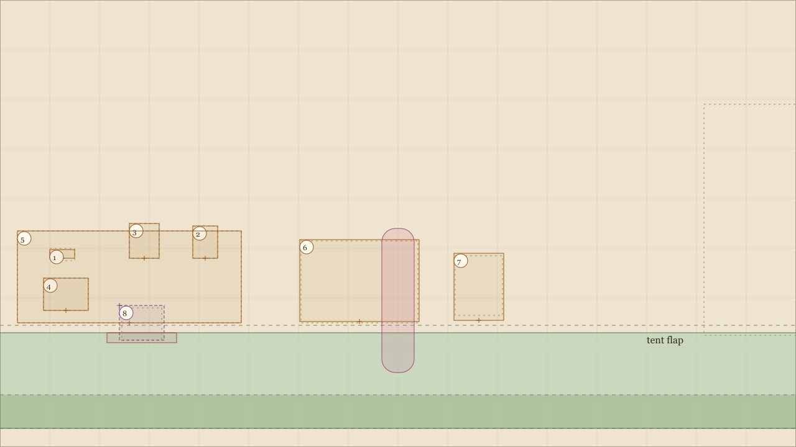

| Clickable | Name | Box (x, y, w×h) | Mara stands at |
| --- | --- | --- | --- |
| `notebook` | mother's notebook | 80, 368, 76×28 | (120, 556) |
| `rack` | charging rack | 292, 256, 104×140 | (344, 556) |
| `jar` | water jar | 208, 336, 52×60 | (236, 556) |
| `chest` | clothes crate | 72, 436, 64×52 | (104, 556) |
| `workbench` | workbench | 28, 248, 356×256 | (220, 556) |
| `stool` | stool | 176, 456, 104×96 | — |
| `drum` | old brush drum | 484, 388, 188×132 | (580, 556) |
| `stove` | clay stove | 732, 412, 76×96 | (770, 556) |
| `tentFlap` | tent flap | 1132, 168, 148×372 | (1212, 568) |

- Object `objects/rack` (112×72, tags full (1), empty (1)): foot point (344, 394). Drawn on top of the room, so the painting should leave that spot free (or show what is behind it).
- Object `objects/notebook` (72×24, tags idle (1)): foot point (116, 394). Drawn on top of the room, so the painting should leave that spot free (or show what is behind it).
- Walk-behind piece `foreground/tent-stool.png` (108×96, top left at (176, 460)): the same pixels as the room painting there, transparent elsewhere. It is drawn in front of anyone standing behind it. Cut it from the new painting.
- The name board hangs from (240, 28) (about 184×64); it is painted by the game, so leave a quiet patch of wall there.
- Heat shimmer (High quality) over: 624, 60, 48×60: hot spots in the painting (fires, lamps, pipes).
- Flickering light pools at (1212, 380), (644, 104): lamps, kiln mouths, hearths in the painting.

### The Kiln Hall: `rooms/mara-room.png`

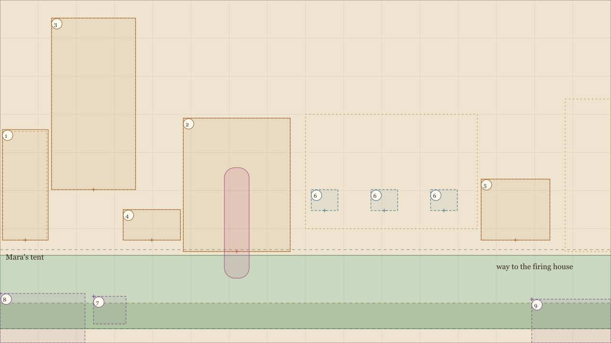

| Clickable | Name | Box (x, y, w×h) | Mara stands at |
| --- | --- | --- | --- |
| `tally` (secret) | scratches on the pillar | 16, 300, 80×140 | (80, 560) |
| `toTent` | Mara's tent | 408, 300, 184×224 | (500, 560) |
| `niche` | kiln mouths | 640, 240, 360×240 | (820, 560) |
| `pulleys` | pulley hoist | 148, 40, 104×340 | (200, 560) |
| `jars` | storage jars | 280, 428, 100×96 | (330, 560) |
| `cart` | ash cart | 1008, 436, 120×88 | (1068, 564) |
| `roomCurtain` | way to the firing house | 1184, 208, 96×320 | (1232, 580) |

- Object `objects/tent` (184×224, tags idle (1)): foot point (500, 528). Drawn on top of the room, so the painting should leave that spot free (or show what is behind it).
- Walk-behind piece `foreground/hall-left.png` (178×104, top left at (0, 616)): the same pixels as the room painting there, transparent elsewhere. It is drawn in front of anyone standing behind it. Cut it from the new painting.
- Walk-behind piece `foreground/hall-right.png` (166×92, top left at (1114, 628)): the same pixels as the room painting there, transparent elsewhere. It is drawn in front of anyone standing behind it. Cut it from the new painting.
- Walk-behind piece `foreground/hall-crate.png` (68×58, top left at (196, 622)): the same pixels as the room painting there, transparent elsewhere. It is drawn in front of anyone standing behind it. Cut it from the new painting.
- Animated prop `props/pulley.png` (swing) at (200, 120): hung from its top edge at that point; it swings.
- The name board hangs from (300, 96) (about 200×72); it is painted by the game, so leave a quiet patch of wall there.
- Heat shimmer (High quality) over: 640, 300, 360×160: hot spots in the painting (fires, lamps, pipes).
- Flickering light pools at (700, 400), (820, 392), (940, 400): lamps, kiln mouths, hearths in the painting.

### The Firing House: `rooms/firing-house.png`

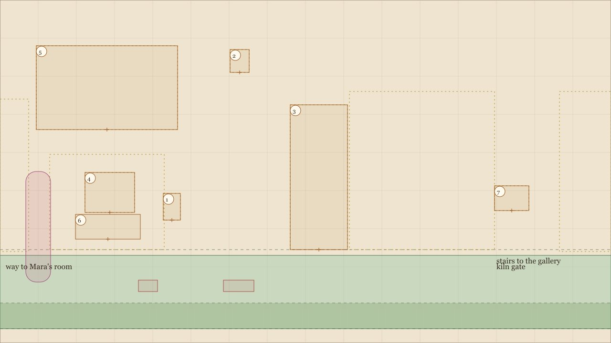

| Clickable | Name | Box (x, y, w×h) | Mara stands at |
| --- | --- | --- | --- |
| `chalk` (secret) | chalk marks | 320, 290, 64×48 | (380, 560) |
| `sign` (secret) | firing-house bell | 452, 88, 68×76 | — |
| `pantryDoor` | Nell's pantry door | 608, 220, 120×304 | (668, 560) |
| `soup` | soup pot | 164, 352, 88×52 | (220, 560) |
| `shoes` | shoe racks | 68, 60, 240×220 | — |
| `hearth` | hearth | 112, 340, 184×184 | — |
| `stairs` | stairs to the gallery | 820, 192, 312×332 | (900, 568) |
| `breadBasket` | bread basket | 1032, 384, 76×56 | (1070, 564) |
| `kilnGate` | kiln gate | 1172, 192, 108×336 | (1232, 580) |
| `toRoom` | way to Mara's room | 0, 208, 60×320 | (48, 580) |

- Object `objects/pantry-door` (240×304, tags stuck (1), fixed (1)): foot point (668, 524). Drawn on top of the room, so the painting should leave that spot free (or show what is behind it).
- Nell stands at (500, 600).
- Tobi stands at (310, 600).
- The name board hangs from (960, 100) (about 224×68); it is painted by the game, so leave a quiet patch of wall there.
- Heat shimmer (High quality) over: 120, 320, 180×140: hot spots in the painting (fires, lamps, pipes).
- Flickering light pools at (204, 460), (1224, 360): lamps, kiln mouths, hearths in the painting.

### Regulator Gallery: `rooms/gallery.png`

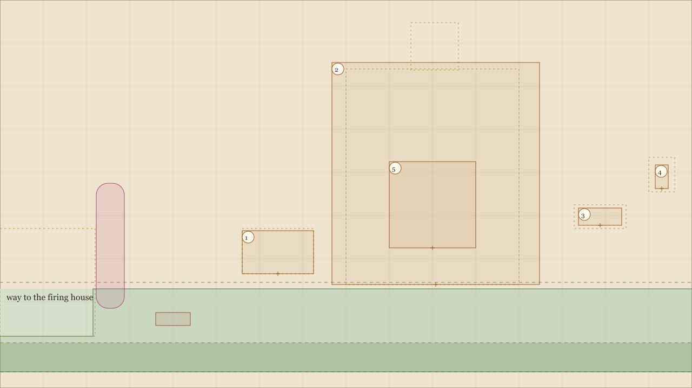

| Clickable | Name | Box (x, y, w×h) | Mara stands at |
| --- | --- | --- | --- |
| `railNames` (secret) | scratched railing | 720, 412, 92×100 | (768, 564) |
| `gauge` | pressure gauge | 432, 42, 88×88 | — |
| `regulator` | regulator | 320, 128, 320×380 | (480, 564) |
| `logbook` | Oren's logbook | 116, 416, 148×108 | — |
| `lantern` | lantern | 28, 280, 68×120 | — |
| `galleryStairs` | way to the firing house | 1172, 208, 108×320 | (1224, 584) |

- Object `objects/socket` (320×160, tags installed (1), removed (1)): foot point (480, 460). Drawn on top of the room, so the painting should leave that spot free (or show what is behind it).
- Animated prop `props/gauge-face.png` (gauge) at (476, 86): a needle-less dial (the game draws the needle), centred there.
- Oren stands at (960, 592).
- The name board hangs from (1040, 120) (about 148×120); it is painted by the game, so leave a quiet patch of wall there.
- Heat shimmer (High quality) over: 400, 0, 160×120: hot spots in the painting (fires, lamps, pipes).
- Flickering light pools at (62, 336), (468, 80): lamps, kiln mouths, hearths in the painting.

### The Ashways: `rooms/ashways.png`

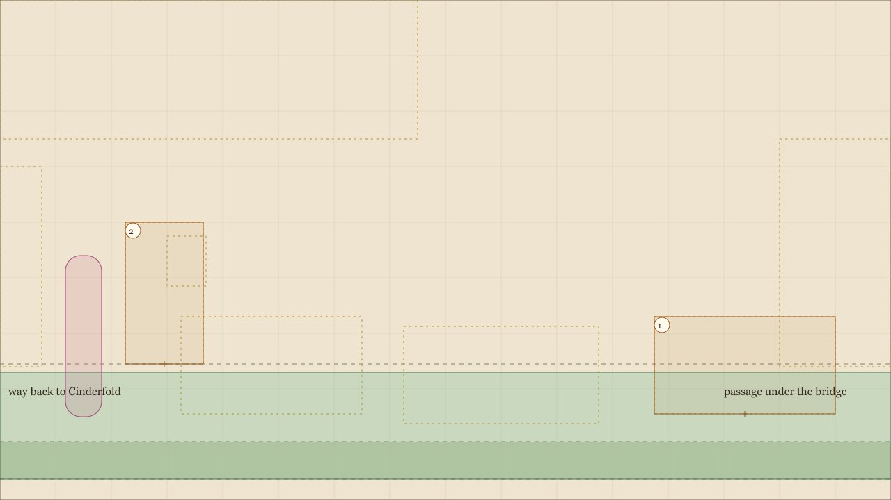

| Clickable | Name | Box (x, y, w×h) | Mara stands at |
| --- | --- | --- | --- |
| `pressureCell` | brass pressure cell | 352, 404, 56×72 | (440, 600) |
| `sweeperDisabled` | ash sweeper | 580, 470, 280×140 | — |
| `sweeper` | ash sweeper | 940, 456, 260×140 | — |
| `sweeperAtPipe` | ash sweeper | 260, 456, 260×140 | — |
| `valve` | steam valve | 180, 320, 112×204 | (300, 564) |
| `passage` | passage under the bridge | 1120, 200, 160×328 | (1216, 584) |
| `pipes` | old pipes | 0, 0, 600×200 | — |
| `wayBack` | way back to Cinderfold | 0, 240, 60×288 | (48, 584) |

- Object `objects/valve` (224×204, tags closed (1), venting (1)): foot point (236, 524). Drawn on top of the room, so the painting should leave that spot free (or show what is behind it).
- Object `objects/sweeper` (520×140, tags idle (1), scurry (1)): foot point (1070, 596), moves to (390, 596). Drawn on top of the room, so the painting should leave that spot free (or show what is behind it).
- The name board hangs from (660, 120) (about 200×72); it is painted by the game, so leave a quiet patch of wall there.
- Flickering light pools at (1200, 340): lamps, kiln mouths, hearths in the painting.

### Service Line 4: `ch2/rooms/tunnel-mouth.png`

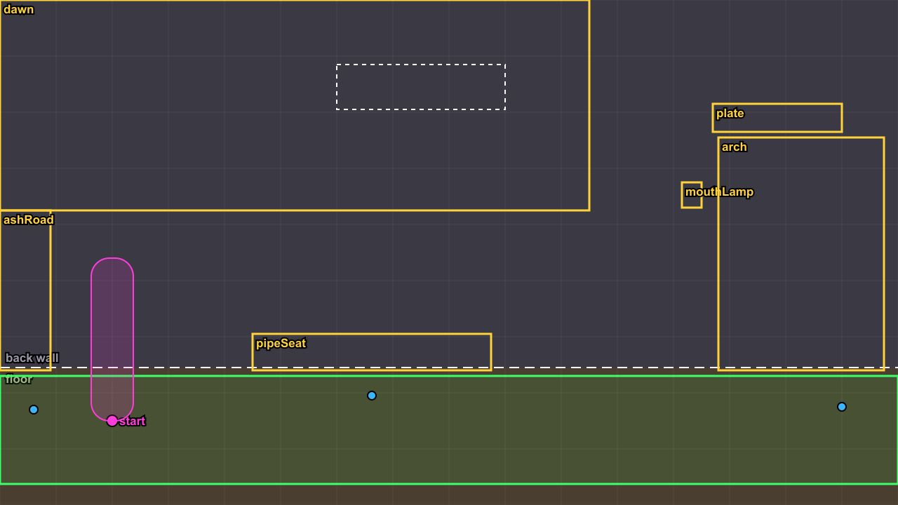

| Clickable | Name | Box (x, y, w×h) | Mara stands at |
| --- | --- | --- | --- |
| `plate` | iron plate | 1016, 148, 184×40 | — |
| `mouthLamp` | lamp | 972, 260, 28×36 | — |
| `arch` | tunnel arch | 1024, 196, 236×332 | (1200, 580) |
| `pipeSeat` | pipe | 360, 476, 340×52 | (530, 564) |
| `dawn` | dawn | 0, 0, 840×300 | — |
| `ashRoad` | ash road | 0, 300, 72×228 | (48, 584) |

- The name board hangs from (600, 92) (about 240×64); it is painted by the game, so leave a quiet patch of wall there.
- Flickering light pools at (986, 280): lamps, kiln mouths, hearths in the painting.

### Collapsed Tunnel: `ch2/rooms/tunnel-collapse.png`

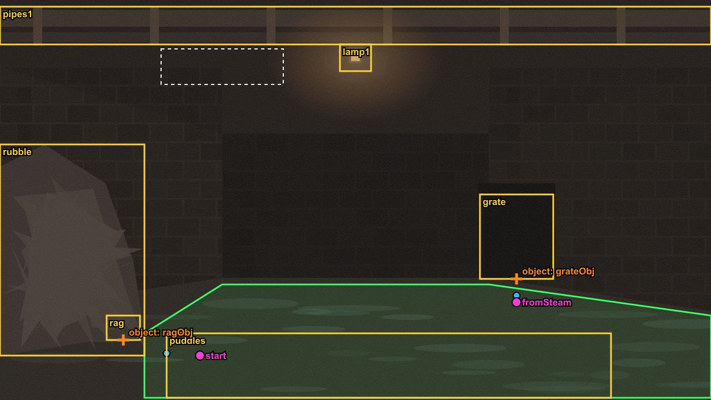

| Clickable | Name | Box (x, y, w×h) | Mara stands at |
| --- | --- | --- | --- |
| `rag` | rag | 248, 540, 60×32 | (340, 584) |
| `grate` | rusted grate | 1120, 300, 148×224 | (1192, 580) |
| `rubble` | rubble | 0, 220, 240×470 | — |
| `lamp1` | lamp | 612, 80, 56×48 | — |
| `pipes1` | pipes | 0, 12, 1280×68 | — |
| `puddles` | puddles | 320, 632, 760×58 | — |

- Object `ch2/objects/rag` (60×46, tags idle (1)): foot point (278, 572). Drawn on top of the room, so the painting should leave that spot free (or show what is behind it).
- Object `ch2/objects/grate` (240×150, tags closed (1), open (1)): foot point (1194, 524). Drawn on top of the room, so the painting should leave that spot free (or show what is behind it).
- The name board hangs from (520, 88) (about 220×64); it is painted by the game, so leave a quiet patch of wall there.
- Flickering light pools at (640, 104): lamps, kiln mouths, hearths in the painting.

### Steam Junction: `ch2/rooms/tunnel-steam.png`

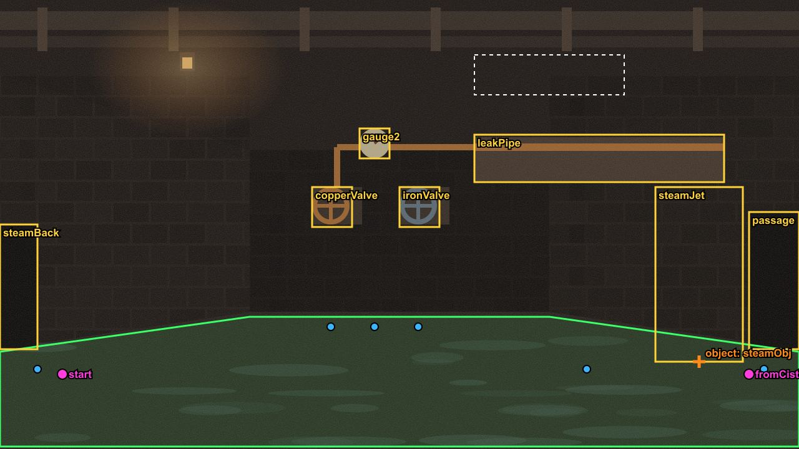

| Clickable | Name | Box (x, y, w×h) | Mara stands at |
| --- | --- | --- | --- |
| `gauge2` | gauge | 576, 280, 48×48 | (600, 564) |
| `copperValve` | copper valve | 500, 372, 64×64 | (528, 564) |
| `ironValve` | iron valve | 640, 372, 64×64 | (676, 564) |
| `steamJet` | steam | 1000, 320, 140×280 | (920, 592) |
| `leakPipe` | leaking pipe | 760, 240, 400×72 | — |
| `passage` | passage | 1192, 240, 88×288 | (1232, 584) |
| `steamBack` | way back | 0, 240, 60×288 | (48, 584) |

- Object `ch2/objects/steam` (280×260, tags on (1), off (1)): foot point (1070, 600). Drawn on top of the room, so the painting should leave that spot free (or show what is behind it).
- The name board hangs from (880, 88) (about 240×64); it is painted by the game, so leave a quiet patch of wall there.
- Flickering light pools at (300, 104): lamps, kiln mouths, hearths in the painting.

### Ash Cistern: `ch2/rooms/tunnel-cistern.png`

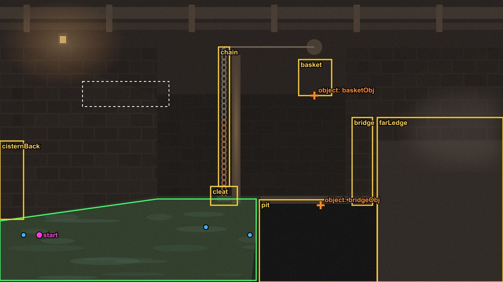

| Clickable | Name | Box (x, y, w×h) | Mara stands at |
| --- | --- | --- | --- |
| `cleat` | cleat | 536, 488, 68×44 | (524, 580) |
| `chain` | chain | 556, 120, 28×368 | (524, 580) |
| `basket` | basket | 760, 152, 84×92 | — |
| `bridge` | drawbridge | 896, 380, 52×220 | — |
| `pit` | pit | 660, 524, 300×166 | — |
| `farLedge` | far ledge | 964, 240, 316×450 | (636, 600) |
| `cisternBack` | way back | 0, 240, 60×288 | (48, 584) |

- Object `ch2/objects/bridge` (640×220, tags up (1), down (1)): foot point (816, 600). Drawn on top of the room, so the painting should leave that spot free (or show what is behind it).
- Object `ch2/objects/basket` (160×90, tags hanging (1), gone (1)): foot point (800, 244). Drawn on top of the room, so the painting should leave that spot free (or show what is behind it).
- The name board hangs from (320, 208) (about 220×64); it is painted by the game, so leave a quiet patch of wall there.
- Flickering light pools at (160, 104), (1180, 360): lamps, kiln mouths, hearths in the painting.

### Bryn's Road: `ch2/rooms/road.png`

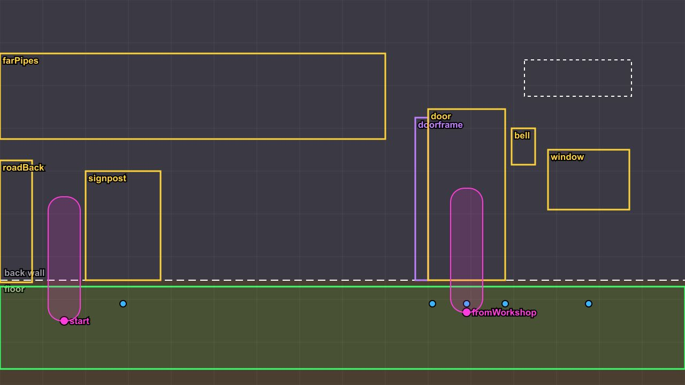

| Clickable | Name | Box (x, y, w×h) | Mara stands at |
| --- | --- | --- | --- |
| `doorframe` (secret) | Doorframe | 776, 220, 24×304 | (808, 568) |
| `bell` | Bell | 956, 240, 44×68 | (944, 568) |
| `door` | Heavy door | 800, 204, 144×320 | (872, 568) |
| `window` | Lit window | 1024, 280, 152×112 | (1100, 568) |
| `signpost` | Signpost | 160, 320, 140×204 | (230, 568) |
| `farPipes` | Pipes in the haze | 0, 100, 720×160 | — |
| `roadBack` | Road back | 0, 300, 60×228 | — |

- The name board hangs from (1080, 112) (about 200×68); it is painted by the game, so leave a quiet patch of wall there.
- Flickering light pools at (1100, 336), (764, 300): lamps, kiln mouths, hearths in the painting.

### Tempering House: `ch2/rooms/workshop.png`

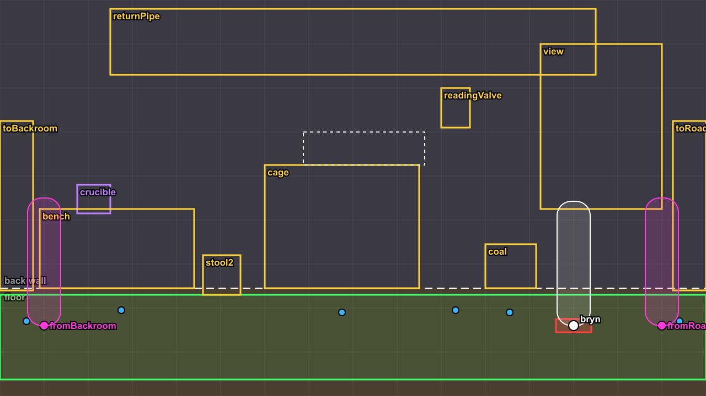

| Clickable | Name | Box (x, y, w×h) | Mara stands at |
| --- | --- | --- | --- |
| `crucible` (secret) | Old crucible | 140, 336, 60×52 | (220, 564) |
| `readingValve` | Reading valve | 800, 160, 52×72 | (826, 564) |
| `stool2` | Stool | 368, 464, 68×72 | — |
| `bench` | Bryn's bench | 72, 380, 280×144 | (220, 564) |
| `cage` | Training cage | 480, 300, 280×224 | (620, 568) |
| `coal` | Coal crate | 880, 444, 92×80 | (924, 568) |
| `toBackroom` | Curtain to the back room | 0, 220, 60×308 | (48, 584) |
| `view` | Open side | 980, 80, 220×300 | — |
| `returnPipe` | Return pipe | 200, 16, 880×120 | — |
| `toRoad` | Out to the road | 1220, 220, 60×308 | (1232, 584) |

- Bryn stands at (1040, 592).
- The name board hangs from (660, 240) (about 220×60); it is painted by the game, so leave a quiet patch of wall there.
- Flickering light pools at (826, 196), (170, 360): lamps, kiln mouths, hearths in the painting.

### Back Room: `ch2/rooms/backroom.png`

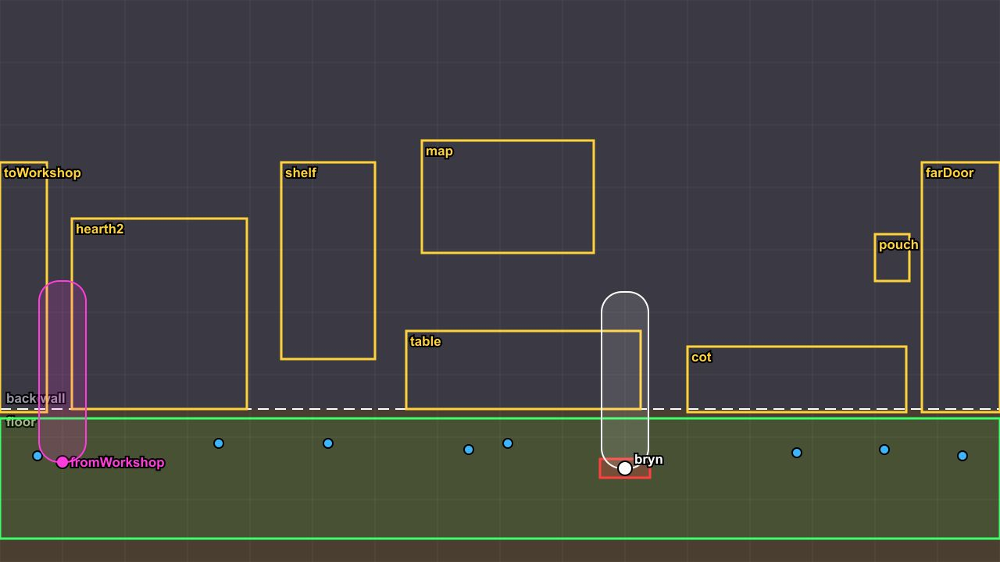

| Clickable | Name | Box (x, y, w×h) | Mara stands at |
| --- | --- | --- | --- |
| `pouch` | Courier's pouch | 1120, 300, 44×60 | (1132, 576) |
| `map` | Map on the wall | 540, 180, 220×144 | (650, 568) |
| `farDoor` | Far door | 1180, 208, 100×320 | (1232, 584) |
| `shelf` | Supply shelf | 360, 208, 120×252 | (420, 568) |
| `hearth2` | Hearth | 92, 280, 224×244 | (280, 568) |
| `table` | Table | 520, 424, 300×100 | (600, 576) |
| `cot` | Cot | 880, 444, 280×84 | (1020, 580) |
| `toWorkshop` | Curtain to the workshop | 0, 208, 60×320 | (48, 584) |

- Bryn stands at (800, 600).
- Flickering light pools at (204, 472), (670, 400): lamps, kiln mouths, hearths in the painting.

### Tsalohi: `kofi1-test/room-tsalohi.png`

Layout image not generated: `spec/room-tsalohi.jpg`.

| Clickable | Name | Box (x, y, w×h) | Mara stands at |
| --- | --- | --- | --- |
| `oweli` | Oweli | 24, 148, 136×64 | (92, 650) |
| `saluna` | Saluna | 180, 148, 136×64 | (248, 650) |
| `tohani` | Tohani | 336, 148, 136×64 | (404, 650) |
| `ahyeli` | Ahyeli | 492, 148, 136×64 | (560, 650) |
| `enali` | Enali | 648, 148, 136×64 | (716, 650) |
| `deyu` | Deyu | 804, 148, 136×64 | (872, 650) |
| `huska` | Huska | 960, 148, 136×64 | (1028, 650) |
| `gate` | Tohani’s gate | 1116, 148, 136×64 | (1184, 650) |
| `bell` | Loose bell | 24, 270, 136×64 | (92, 650) |
| `cloth` | Pot cloth | 180, 270, 136×64 | (248, 650) |
| `pot` | Hot pot | 336, 270, 136×64 | (404, 650) |
| `trestle` | Deyu’s trestle | 492, 270, 136×64 | (560, 650) |
| `coop` | Chicken coop | 648, 270, 136×64 | (716, 650) |
| `coop` | Chicken coop | 24, 148, 136×64 | (92, 650) |
| `scoop` | Grain scoop | 804, 270, 136×64 | (872, 650) |
| `hook` | Scoop hook | 960, 270, 136×64 | (1028, 650) |
| `inland` | Inland gate | 1116, 270, 136×64 | (1184, 650) |
| `inland` | Inland gate | 180, 148, 136×64 | (248, 650) |
| `enaliRescue` | Enali — left ledge | 336, 148, 136×64 | (404, 650) |
| `deyuRescue` | Deyu — right ledge | 492, 148, 136×64 | (560, 650) |

- Object `kofi1-test/prop-tsalohi-oweli` (272×64, tags idle (1), done (1)): foot point (92, 212). Drawn on top of the room, so the painting should leave that spot free (or show what is behind it).
- Object `kofi1-test/prop-tsalohi-saluna` (272×64, tags idle (1), done (1)): foot point (248, 212). Drawn on top of the room, so the painting should leave that spot free (or show what is behind it).
- Object `kofi1-test/prop-tsalohi-tohani` (272×64, tags idle (1), done (1)): foot point (404, 212). Drawn on top of the room, so the painting should leave that spot free (or show what is behind it).
- Object `kofi1-test/prop-tsalohi-ahyeli` (272×64, tags idle (1), done (1)): foot point (560, 212). Drawn on top of the room, so the painting should leave that spot free (or show what is behind it).
- Object `kofi1-test/prop-tsalohi-enali` (272×64, tags idle (1), done (1)): foot point (716, 212). Drawn on top of the room, so the painting should leave that spot free (or show what is behind it).
- Object `kofi1-test/prop-tsalohi-deyu` (272×64, tags idle (1), done (1)): foot point (872, 212). Drawn on top of the room, so the painting should leave that spot free (or show what is behind it).
- Object `kofi1-test/prop-tsalohi-huska` (272×64, tags idle (1), done (1)): foot point (1028, 212). Drawn on top of the room, so the painting should leave that spot free (or show what is behind it).
- Object `kofi1-test/prop-tsalohi-gate` (272×64, tags idle (1), done (1)): foot point (1184, 212). Drawn on top of the room, so the painting should leave that spot free (or show what is behind it).
- Object `kofi1-test/prop-tsalohi-bell` (272×64, tags idle (1), done (1)): foot point (92, 334). Drawn on top of the room, so the painting should leave that spot free (or show what is behind it).
- Object `kofi1-test/prop-tsalohi-cloth` (272×64, tags idle (1), done (1)): foot point (248, 334). Drawn on top of the room, so the painting should leave that spot free (or show what is behind it).
- Object `kofi1-test/prop-tsalohi-pot` (272×64, tags idle (1), done (1)): foot point (404, 334). Drawn on top of the room, so the painting should leave that spot free (or show what is behind it).
- Object `kofi1-test/prop-tsalohi-trestle` (272×64, tags idle (1), done (1)): foot point (560, 334). Drawn on top of the room, so the painting should leave that spot free (or show what is behind it).
- Object `kofi1-test/prop-tsalohi-coop` (272×64, tags idle (1), done (1)): foot point (716, 334). Drawn on top of the room, so the painting should leave that spot free (or show what is behind it).
- Object `kofi1-test/prop-tsalohi-coop` (272×64, tags idle (1), done (1)): foot point (92, 212). Drawn on top of the room, so the painting should leave that spot free (or show what is behind it).
- Object `kofi1-test/prop-tsalohi-scoop` (272×64, tags idle (1), done (1)): foot point (872, 334). Drawn on top of the room, so the painting should leave that spot free (or show what is behind it).
- Object `kofi1-test/prop-tsalohi-hook` (272×64, tags idle (1), done (1)): foot point (1028, 334). Drawn on top of the room, so the painting should leave that spot free (or show what is behind it).
- Object `kofi1-test/prop-tsalohi-inland` (272×64, tags idle (1), done (1)): foot point (1184, 334). Drawn on top of the room, so the painting should leave that spot free (or show what is behind it).
- Object `kofi1-test/prop-tsalohi-inland` (272×64, tags idle (1), done (1)): foot point (248, 212). Drawn on top of the room, so the painting should leave that spot free (or show what is behind it).
- Object `kofi1-test/prop-tsalohi-enaliRescue` (272×64, tags idle (1), done (1)): foot point (404, 212). Drawn on top of the room, so the painting should leave that spot free (or show what is behind it).
- Object `kofi1-test/prop-tsalohi-deyuRescue` (272×64, tags idle (1), done (1)): foot point (560, 212). Drawn on top of the room, so the painting should leave that spot free (or show what is behind it).

### Trail camp: `kofi1-test/room-camp.png`

Layout image not generated: `spec/room-camp.jpg`.

| Clickable | Name | Box (x, y, w×h) | Mara stands at |
| --- | --- | --- | --- |
| `oweli` | Oweli | 24, 148, 136×64 | (92, 650) |
| `saluna` | Saluna | 180, 148, 136×64 | (248, 650) |
| `tohani` | Tohani | 336, 148, 136×64 | (404, 650) |
| `ahyeli` | Ahyeli | 492, 148, 136×64 | (560, 650) |
| `enali` | Enali | 648, 148, 136×64 | (716, 650) |
| `deyu` | Deyu | 804, 148, 136×64 | (872, 650) |
| `huska` | Huska | 960, 148, 136×64 | (1028, 650) |
| `deadBough` | Dry stick caught in a dead bough | 1116, 148, 136×64 | (1184, 650) |
| `branch` | Dislodged dry branch | 24, 270, 136×64 | (92, 650) |
| `herd` | Herd in the dark | 180, 270, 136×64 | (248, 650) |
| `fire` | Cook fire | 336, 270, 136×64 | (404, 650) |
| `trail` | Trail at dawn | 492, 270, 136×64 | (560, 650) |

- Object `kofi1-test/prop-camp-oweli` (272×64, tags idle (1), done (1)): foot point (92, 212). Drawn on top of the room, so the painting should leave that spot free (or show what is behind it).
- Object `kofi1-test/prop-camp-saluna` (272×64, tags idle (1), done (1)): foot point (248, 212). Drawn on top of the room, so the painting should leave that spot free (or show what is behind it).
- Object `kofi1-test/prop-camp-tohani` (272×64, tags idle (1), done (1)): foot point (404, 212). Drawn on top of the room, so the painting should leave that spot free (or show what is behind it).
- Object `kofi1-test/prop-camp-ahyeli` (272×64, tags idle (1), done (1)): foot point (560, 212). Drawn on top of the room, so the painting should leave that spot free (or show what is behind it).
- Object `kofi1-test/prop-camp-enali` (272×64, tags idle (1), done (1)): foot point (716, 212). Drawn on top of the room, so the painting should leave that spot free (or show what is behind it).
- Object `kofi1-test/prop-camp-deyu` (272×64, tags idle (1), done (1)): foot point (872, 212). Drawn on top of the room, so the painting should leave that spot free (or show what is behind it).
- Object `kofi1-test/prop-camp-huska` (272×64, tags idle (1), done (1)): foot point (1028, 212). Drawn on top of the room, so the painting should leave that spot free (or show what is behind it).
- Object `kofi1-test/prop-camp-deadBough` (272×64, tags idle (1), done (1)): foot point (1184, 212). Drawn on top of the room, so the painting should leave that spot free (or show what is behind it).
- Object `kofi1-test/prop-camp-branch` (272×64, tags idle (1), done (1)): foot point (92, 334). Drawn on top of the room, so the painting should leave that spot free (or show what is behind it).
- Object `kofi1-test/prop-camp-herd` (272×64, tags idle (1), done (1)): foot point (248, 334). Drawn on top of the room, so the painting should leave that spot free (or show what is behind it).
- Object `kofi1-test/prop-camp-fire` (272×64, tags idle (1), done (1)): foot point (404, 334). Drawn on top of the room, so the painting should leave that spot free (or show what is behind it).
- Object `kofi1-test/prop-camp-trail` (272×64, tags idle (1), done (1)): foot point (560, 334). Drawn on top of the room, so the painting should leave that spot free (or show what is behind it).

### Riverbank: `kofi1-test/room-river.png`

Layout image not generated: `spec/room-river.jpg`.

| Clickable | Name | Box (x, y, w×h) | Mara stands at |
| --- | --- | --- | --- |
| `oweli` | Oweli | 24, 148, 136×64 | (92, 650) |
| `oweli` | Oweli | 24, 148, 136×64 | (92, 650) |
| `oweli` | Oweli | 24, 148, 136×64 | (92, 650) |
| `oweli` | Oweli | 24, 148, 136×64 | (92, 650) |
| `oweli` | Oweli | 24, 148, 136×64 | (92, 650) |
| `saluna` | Saluna | 180, 148, 136×64 | (248, 650) |
| `saluna` | Saluna | 180, 148, 136×64 | (248, 650) |
| `saluna` | Saluna | 180, 148, 136×64 | (248, 650) |
| `saluna` | Saluna | 180, 148, 136×64 | (248, 650) |
| `saluna` | Saluna | 180, 148, 136×64 | (248, 650) |
| `tohani` | Tohani | 336, 148, 136×64 | (404, 650) |
| `tohani` | Tohani | 336, 148, 136×64 | (404, 650) |
| `tohani` | Tohani | 336, 148, 136×64 | (404, 650) |
| `tohani` | Tohani | 336, 148, 136×64 | (404, 650) |
| `tohani` | Tohani | 336, 148, 136×64 | (404, 650) |
| `ahyeli` | Ahyeli | 492, 148, 136×64 | (560, 650) |
| `ahyeli` | Ahyeli | 492, 148, 136×64 | (560, 650) |
| `ahyeli` | Ahyeli | 492, 148, 136×64 | (560, 650) |
| `ahyeli` | Ahyeli | 492, 148, 136×64 | (560, 650) |
| `ahyeli` | Ahyeli | 492, 148, 136×64 | (560, 650) |
| `enali` | Enali | 648, 148, 136×64 | (716, 650) |
| `enali` | Enali | 648, 148, 136×64 | (716, 650) |
| `enali` | Enali | 648, 148, 136×64 | (716, 650) |
| `enali` | Enali | 648, 148, 136×64 | (716, 650) |
| `enali` | Enali | 648, 148, 136×64 | (716, 650) |
| `deyu` | Deyu | 804, 148, 136×64 | (872, 650) |
| `deyu` | Deyu | 804, 148, 136×64 | (872, 650) |
| `deyu` | Deyu | 804, 148, 136×64 | (872, 650) |
| `deyu` | Deyu | 804, 148, 136×64 | (872, 650) |
| `deyu` | Deyu | 804, 148, 136×64 | (872, 650) |
| `huska` | Huska | 960, 148, 136×64 | (1028, 650) |
| `huska` | Huska | 960, 148, 136×64 | (1028, 650) |
| `huska` | Huska | 960, 148, 136×64 | (1028, 650) |
| `huska` | Huska | 960, 148, 136×64 | (1028, 650) |
| `huska` | Huska | 960, 148, 136×64 | (1028, 650) |
| `mud` | Muddy intake | 1116, 148, 136×64 | (1184, 650) |
| `seep` | Upper seep | 24, 270, 136×64 | (92, 650) |
| `trough` | Salvaged trough | 180, 270, 136×64 | (248, 650) |
| `bundle` | Communal bundle | 336, 270, 136×64 | (404, 650) |
| `tracks` | Uphill goat tracks | 492, 270, 136×64 | (560, 650) |
| `leaves` | Leaves over the inflow | 648, 270, 136×64 | (716, 650) |
| `twig` | Fallen twig | 804, 270, 136×64 | (872, 650) |
| `shore` | Flat shore stones | 960, 270, 136×64 | (1028, 650) |
| `screen` | Reed grit screen | 1116, 270, 136×64 | (1184, 650) |
| `pot` | Shared cook pot | 24, 392, 136×64 | (92, 650) |
| `fire` | Cook fire | 180, 392, 136×64 | (248, 650) |
| `sheath` | Axe sheath | 1116, 148, 136×64 | (1184, 650) |
| `search` | Trampled reeds | 24, 270, 136×64 | (92, 650) |
| `axe` | Exposed axe | 180, 270, 136×64 | (248, 650) |
| `mature` | Mature reeds | 336, 270, 136×64 | (404, 650) |
| `young` | Young reeds | 492, 270, 136×64 | (560, 650) |
| `clay` | Bank clay | 648, 270, 136×64 | (716, 650) |
| `sledge` | Hauling sledge | 804, 270, 136×64 | (872, 650) |
| `browse` | Cut leafy browse | 960, 270, 136×64 | (1028, 650) |
| `bowl` | Feed bowl | 1116, 270, 136×64 | (1184, 650) |
| `lead` | Nanny’s lead rope | 24, 392, 136×64 | (92, 650) |
| `frame` | Ground-hut reed wall | 180, 392, 136×64 | (248, 650) |
| `mix` | Clay mixing hollow | 336, 392, 136×64 | (404, 650) |
| `washing` | Washing-water pot | 492, 392, 136×64 | (560, 650) |
| `cord` | Light cord | 648, 392, 136×64 | (716, 650) |
| `rack` | Communal tools | 804, 392, 136×64 | (872, 650) |
| `toClearing` | Path to woodland clearing | 960, 392, 136×64 | (1028, 650) |
| `toClearing` | Path to woodland clearing | 1116, 148, 136×64 | (1184, 650) |
| `toClearing` | Path to woodland clearing | 1116, 148, 136×64 | (1184, 650) |
| `toClearing` | Path to woodland clearing | 1116, 148, 136×64 | (1184, 650) |
| `riteStone` | Smooth river stone | 24, 270, 136×64 | (92, 650) |
| `riverOffering` | River offering space | 180, 270, 136×64 | (248, 650) |
| `treeOffering` | Tree offering space | 336, 270, 136×64 | (404, 650) |
| `animalOffering` | Animals offering space | 492, 270, 136×64 | (560, 650) |
| `homeOffering` | Old-home offering space | 648, 270, 136×64 | (716, 650) |
| `circle` | Founding circle | 804, 270, 136×64 | (872, 650) |
| `garden` | Bitten garden shoots | 24, 270, 136×64 | (92, 650) |
| `gap` | Watering path gap | 180, 270, 136×64 | (248, 650) |
| `gardenPlan` | Propose a garden agreement | 336, 270, 136×64 | (404, 650) |
| `watchPlan` | Propose a watch agreement | 492, 270, 136×64 | (560, 650) |
| `hutPlan` | Propose a hut agreement | 648, 270, 136×64 | (716, 650) |
| `lateVolunteer` | Late-watch volunteer | 804, 270, 136×64 | (872, 650) |
| `waterVolunteer` | Water-round volunteer | 960, 270, 136×64 | (1028, 650) |
| `breakfastVolunteer` | Breakfast volunteer | 1116, 270, 136×64 | (1184, 650) |
| `doors` | Ground-home doors | 24, 392, 136×64 | (92, 650) |
| `rack` | Communal supply rack | 180, 392, 136×64 | (248, 650) |
| `rack` | Hunting kit / go hunting | 24, 270, 136×64 | (92, 650) |

- Object `kofi1-test/prop-river-oweli` (272×64, tags idle (1), done (1)): foot point (92, 212). Drawn on top of the room, so the painting should leave that spot free (or show what is behind it).
- Object `kofi1-test/prop-river-oweli` (272×64, tags idle (1), done (1)): foot point (92, 212). Drawn on top of the room, so the painting should leave that spot free (or show what is behind it).
- Object `kofi1-test/prop-river-oweli` (272×64, tags idle (1), done (1)): foot point (92, 212). Drawn on top of the room, so the painting should leave that spot free (or show what is behind it).
- Object `kofi1-test/prop-river-oweli` (272×64, tags idle (1), done (1)): foot point (92, 212). Drawn on top of the room, so the painting should leave that spot free (or show what is behind it).
- Object `kofi1-test/prop-river-oweli` (272×64, tags idle (1), done (1)): foot point (92, 212). Drawn on top of the room, so the painting should leave that spot free (or show what is behind it).
- Object `kofi1-test/prop-river-saluna` (272×64, tags idle (1), done (1)): foot point (248, 212). Drawn on top of the room, so the painting should leave that spot free (or show what is behind it).
- Object `kofi1-test/prop-river-saluna` (272×64, tags idle (1), done (1)): foot point (248, 212). Drawn on top of the room, so the painting should leave that spot free (or show what is behind it).
- Object `kofi1-test/prop-river-saluna` (272×64, tags idle (1), done (1)): foot point (248, 212). Drawn on top of the room, so the painting should leave that spot free (or show what is behind it).
- Object `kofi1-test/prop-river-saluna` (272×64, tags idle (1), done (1)): foot point (248, 212). Drawn on top of the room, so the painting should leave that spot free (or show what is behind it).
- Object `kofi1-test/prop-river-saluna` (272×64, tags idle (1), done (1)): foot point (248, 212). Drawn on top of the room, so the painting should leave that spot free (or show what is behind it).
- Object `kofi1-test/prop-river-tohani` (272×64, tags idle (1), done (1)): foot point (404, 212). Drawn on top of the room, so the painting should leave that spot free (or show what is behind it).
- Object `kofi1-test/prop-river-tohani` (272×64, tags idle (1), done (1)): foot point (404, 212). Drawn on top of the room, so the painting should leave that spot free (or show what is behind it).
- Object `kofi1-test/prop-river-tohani` (272×64, tags idle (1), done (1)): foot point (404, 212). Drawn on top of the room, so the painting should leave that spot free (or show what is behind it).
- Object `kofi1-test/prop-river-tohani` (272×64, tags idle (1), done (1)): foot point (404, 212). Drawn on top of the room, so the painting should leave that spot free (or show what is behind it).
- Object `kofi1-test/prop-river-tohani` (272×64, tags idle (1), done (1)): foot point (404, 212). Drawn on top of the room, so the painting should leave that spot free (or show what is behind it).
- Object `kofi1-test/prop-river-ahyeli` (272×64, tags idle (1), done (1)): foot point (560, 212). Drawn on top of the room, so the painting should leave that spot free (or show what is behind it).
- Object `kofi1-test/prop-river-ahyeli` (272×64, tags idle (1), done (1)): foot point (560, 212). Drawn on top of the room, so the painting should leave that spot free (or show what is behind it).
- Object `kofi1-test/prop-river-ahyeli` (272×64, tags idle (1), done (1)): foot point (560, 212). Drawn on top of the room, so the painting should leave that spot free (or show what is behind it).
- Object `kofi1-test/prop-river-ahyeli` (272×64, tags idle (1), done (1)): foot point (560, 212). Drawn on top of the room, so the painting should leave that spot free (or show what is behind it).
- Object `kofi1-test/prop-river-ahyeli` (272×64, tags idle (1), done (1)): foot point (560, 212). Drawn on top of the room, so the painting should leave that spot free (or show what is behind it).
- Object `kofi1-test/prop-river-enali` (272×64, tags idle (1), done (1)): foot point (716, 212). Drawn on top of the room, so the painting should leave that spot free (or show what is behind it).
- Object `kofi1-test/prop-river-enali` (272×64, tags idle (1), done (1)): foot point (716, 212). Drawn on top of the room, so the painting should leave that spot free (or show what is behind it).
- Object `kofi1-test/prop-river-enali` (272×64, tags idle (1), done (1)): foot point (716, 212). Drawn on top of the room, so the painting should leave that spot free (or show what is behind it).
- Object `kofi1-test/prop-river-enali` (272×64, tags idle (1), done (1)): foot point (716, 212). Drawn on top of the room, so the painting should leave that spot free (or show what is behind it).
- Object `kofi1-test/prop-river-enali` (272×64, tags idle (1), done (1)): foot point (716, 212). Drawn on top of the room, so the painting should leave that spot free (or show what is behind it).
- Object `kofi1-test/prop-river-deyu` (272×64, tags idle (1), done (1)): foot point (872, 212). Drawn on top of the room, so the painting should leave that spot free (or show what is behind it).
- Object `kofi1-test/prop-river-deyu` (272×64, tags idle (1), done (1)): foot point (872, 212). Drawn on top of the room, so the painting should leave that spot free (or show what is behind it).
- Object `kofi1-test/prop-river-deyu` (272×64, tags idle (1), done (1)): foot point (872, 212). Drawn on top of the room, so the painting should leave that spot free (or show what is behind it).
- Object `kofi1-test/prop-river-deyu` (272×64, tags idle (1), done (1)): foot point (872, 212). Drawn on top of the room, so the painting should leave that spot free (or show what is behind it).
- Object `kofi1-test/prop-river-deyu` (272×64, tags idle (1), done (1)): foot point (872, 212). Drawn on top of the room, so the painting should leave that spot free (or show what is behind it).
- Object `kofi1-test/prop-river-huska` (272×64, tags idle (1), done (1)): foot point (1028, 212). Drawn on top of the room, so the painting should leave that spot free (or show what is behind it).
- Object `kofi1-test/prop-river-huska` (272×64, tags idle (1), done (1)): foot point (1028, 212). Drawn on top of the room, so the painting should leave that spot free (or show what is behind it).
- Object `kofi1-test/prop-river-huska` (272×64, tags idle (1), done (1)): foot point (1028, 212). Drawn on top of the room, so the painting should leave that spot free (or show what is behind it).
- Object `kofi1-test/prop-river-huska` (272×64, tags idle (1), done (1)): foot point (1028, 212). Drawn on top of the room, so the painting should leave that spot free (or show what is behind it).
- Object `kofi1-test/prop-river-huska` (272×64, tags idle (1), done (1)): foot point (1028, 212). Drawn on top of the room, so the painting should leave that spot free (or show what is behind it).
- Object `kofi1-test/prop-river-mud` (272×64, tags idle (1), done (1)): foot point (1184, 212). Drawn on top of the room, so the painting should leave that spot free (or show what is behind it).
- Object `kofi1-test/prop-river-seep` (272×64, tags idle (1), done (1)): foot point (92, 334). Drawn on top of the room, so the painting should leave that spot free (or show what is behind it).
- Object `kofi1-test/prop-river-trough` (272×64, tags idle (1), done (1)): foot point (248, 334). Drawn on top of the room, so the painting should leave that spot free (or show what is behind it).
- Object `kofi1-test/prop-river-bundle` (272×64, tags idle (1), done (1)): foot point (404, 334). Drawn on top of the room, so the painting should leave that spot free (or show what is behind it).
- Object `kofi1-test/prop-river-tracks` (272×64, tags idle (1), done (1)): foot point (560, 334). Drawn on top of the room, so the painting should leave that spot free (or show what is behind it).
- Object `kofi1-test/prop-river-leaves` (272×64, tags idle (1), done (1)): foot point (716, 334). Drawn on top of the room, so the painting should leave that spot free (or show what is behind it).
- Object `kofi1-test/prop-river-twig` (272×64, tags idle (1), done (1)): foot point (872, 334). Drawn on top of the room, so the painting should leave that spot free (or show what is behind it).
- Object `kofi1-test/prop-river-shore` (272×64, tags idle (1), done (1)): foot point (1028, 334). Drawn on top of the room, so the painting should leave that spot free (or show what is behind it).
- Object `kofi1-test/prop-river-screen` (272×64, tags idle (1), done (1)): foot point (1184, 334). Drawn on top of the room, so the painting should leave that spot free (or show what is behind it).
- Object `kofi1-test/prop-river-pot` (272×64, tags idle (1), done (1)): foot point (92, 456). Drawn on top of the room, so the painting should leave that spot free (or show what is behind it).
- Object `kofi1-test/prop-river-fire` (272×64, tags idle (1), done (1)): foot point (248, 456). Drawn on top of the room, so the painting should leave that spot free (or show what is behind it).
- Object `kofi1-test/prop-river-sheath` (272×64, tags idle (1), done (1)): foot point (1184, 212). Drawn on top of the room, so the painting should leave that spot free (or show what is behind it).
- Object `kofi1-test/prop-river-search` (272×64, tags idle (1), done (1)): foot point (92, 334). Drawn on top of the room, so the painting should leave that spot free (or show what is behind it).
- Object `kofi1-test/prop-river-axe` (272×64, tags idle (1), done (1)): foot point (248, 334). Drawn on top of the room, so the painting should leave that spot free (or show what is behind it).
- Object `kofi1-test/prop-river-mature` (272×64, tags idle (1), done (1)): foot point (404, 334). Drawn on top of the room, so the painting should leave that spot free (or show what is behind it).
- Object `kofi1-test/prop-river-young` (272×64, tags idle (1), done (1)): foot point (560, 334). Drawn on top of the room, so the painting should leave that spot free (or show what is behind it).
- Object `kofi1-test/prop-river-clay` (272×64, tags idle (1), done (1)): foot point (716, 334). Drawn on top of the room, so the painting should leave that spot free (or show what is behind it).
- Object `kofi1-test/prop-river-sledge` (272×64, tags idle (1), done (1)): foot point (872, 334). Drawn on top of the room, so the painting should leave that spot free (or show what is behind it).
- Object `kofi1-test/prop-river-browse` (272×64, tags idle (1), done (1)): foot point (1028, 334). Drawn on top of the room, so the painting should leave that spot free (or show what is behind it).
- Object `kofi1-test/prop-river-bowl` (272×64, tags idle (1), done (1)): foot point (1184, 334). Drawn on top of the room, so the painting should leave that spot free (or show what is behind it).
- Object `kofi1-test/prop-river-lead` (272×64, tags idle (1), done (1)): foot point (92, 456). Drawn on top of the room, so the painting should leave that spot free (or show what is behind it).
- Object `kofi1-test/prop-river-frame` (272×64, tags idle (1), done (1)): foot point (248, 456). Drawn on top of the room, so the painting should leave that spot free (or show what is behind it).
- Object `kofi1-test/prop-river-mix` (272×64, tags idle (1), done (1)): foot point (404, 456). Drawn on top of the room, so the painting should leave that spot free (or show what is behind it).
- Object `kofi1-test/prop-river-washing` (272×64, tags idle (1), done (1)): foot point (560, 456). Drawn on top of the room, so the painting should leave that spot free (or show what is behind it).
- Object `kofi1-test/prop-river-cord` (272×64, tags idle (1), done (1)): foot point (716, 456). Drawn on top of the room, so the painting should leave that spot free (or show what is behind it).
- Object `kofi1-test/prop-river-rack` (272×64, tags idle (1), done (1)): foot point (872, 456). Drawn on top of the room, so the painting should leave that spot free (or show what is behind it).
- Object `kofi1-test/prop-river-toClearing` (272×64, tags idle (1), done (1)): foot point (1028, 456). Drawn on top of the room, so the painting should leave that spot free (or show what is behind it).
- Object `kofi1-test/prop-river-toClearing` (272×64, tags idle (1), done (1)): foot point (1184, 212). Drawn on top of the room, so the painting should leave that spot free (or show what is behind it).
- Object `kofi1-test/prop-river-toClearing` (272×64, tags idle (1), done (1)): foot point (1184, 212). Drawn on top of the room, so the painting should leave that spot free (or show what is behind it).
- Object `kofi1-test/prop-river-toClearing` (272×64, tags idle (1), done (1)): foot point (1184, 212). Drawn on top of the room, so the painting should leave that spot free (or show what is behind it).
- Object `kofi1-test/prop-river-riteStone` (272×64, tags idle (1), done (1)): foot point (92, 334). Drawn on top of the room, so the painting should leave that spot free (or show what is behind it).
- Object `kofi1-test/prop-river-riverOffering` (272×64, tags idle (1), done (1)): foot point (248, 334). Drawn on top of the room, so the painting should leave that spot free (or show what is behind it).
- Object `kofi1-test/prop-river-treeOffering` (272×64, tags idle (1), done (1)): foot point (404, 334). Drawn on top of the room, so the painting should leave that spot free (or show what is behind it).
- Object `kofi1-test/prop-river-animalOffering` (272×64, tags idle (1), done (1)): foot point (560, 334). Drawn on top of the room, so the painting should leave that spot free (or show what is behind it).
- Object `kofi1-test/prop-river-homeOffering` (272×64, tags idle (1), done (1)): foot point (716, 334). Drawn on top of the room, so the painting should leave that spot free (or show what is behind it).
- Object `kofi1-test/prop-river-circle` (272×64, tags idle (1), done (1)): foot point (872, 334). Drawn on top of the room, so the painting should leave that spot free (or show what is behind it).
- Object `kofi1-test/prop-river-garden` (272×64, tags idle (1), done (1)): foot point (92, 334). Drawn on top of the room, so the painting should leave that spot free (or show what is behind it).
- Object `kofi1-test/prop-river-gap` (272×64, tags idle (1), done (1)): foot point (248, 334). Drawn on top of the room, so the painting should leave that spot free (or show what is behind it).
- Object `kofi1-test/prop-river-gardenPlan` (272×64, tags idle (1), done (1)): foot point (404, 334). Drawn on top of the room, so the painting should leave that spot free (or show what is behind it).
- Object `kofi1-test/prop-river-watchPlan` (272×64, tags idle (1), done (1)): foot point (560, 334). Drawn on top of the room, so the painting should leave that spot free (or show what is behind it).
- Object `kofi1-test/prop-river-hutPlan` (272×64, tags idle (1), done (1)): foot point (716, 334). Drawn on top of the room, so the painting should leave that spot free (or show what is behind it).
- Object `kofi1-test/prop-river-lateVolunteer` (272×64, tags idle (1), done (1)): foot point (872, 334). Drawn on top of the room, so the painting should leave that spot free (or show what is behind it).
- Object `kofi1-test/prop-river-waterVolunteer` (272×64, tags idle (1), done (1)): foot point (1028, 334). Drawn on top of the room, so the painting should leave that spot free (or show what is behind it).
- Object `kofi1-test/prop-river-breakfastVolunteer` (272×64, tags idle (1), done (1)): foot point (1184, 334). Drawn on top of the room, so the painting should leave that spot free (or show what is behind it).
- Object `kofi1-test/prop-river-doors` (272×64, tags idle (1), done (1)): foot point (92, 456). Drawn on top of the room, so the painting should leave that spot free (or show what is behind it).
- Object `kofi1-test/prop-river-rack` (272×64, tags idle (1), done (1)): foot point (248, 456). Drawn on top of the room, so the painting should leave that spot free (or show what is behind it).
- Object `kofi1-test/prop-river-rack` (272×64, tags idle (1), done (1)): foot point (92, 334). Drawn on top of the room, so the painting should leave that spot free (or show what is behind it).
- Object `kofi1-test/prop-river-waterPoint` (272×64, tags idle (1), done (1)): foot point (184, 568). Drawn on top of the room, so the painting should leave that spot free (or show what is behind it).
- Object `kofi1-test/prop-river-groundHomes` (272×64, tags idle (1), done (1)): foot point (500, 568). Drawn on top of the room, so the painting should leave that spot free (or show what is behind it).
- Object `kofi1-test/prop-river-gardens` (272×64, tags idle (1), done (1)): foot point (820, 568). Drawn on top of the room, so the painting should leave that spot free (or show what is behind it).
- Object `kofi1-test/prop-river-riteCircle` (272×64, tags idle (1), done (1)): foot point (1130, 568). Drawn on top of the room, so the painting should leave that spot free (or show what is behind it).

### Woodland clearing: `kofi1-test/room-clearing.png`

Layout image not generated: `spec/room-clearing.jpg`.

| Clickable | Name | Box (x, y, w×h) | Mara stands at |
| --- | --- | --- | --- |
| `fork` | High branch fork | 24, 148, 136×64 | (92, 650) |
| `bark` | Loose bark on fallen timber | 180, 148, 136×64 | (248, 650) |
| `board` | Work board | 336, 148, 136×64 | (404, 650) |
| `rig` | Hanging line | 492, 148, 136×64 | (560, 650) |
| `cradle` | Beam cradle | 648, 148, 136×64 | (716, 650) |
| `platform` | Low tree platform | 24, 148, 136×64 | (92, 650) |
| `board` | Watch board and charcoal | 24, 148, 136×64 | (92, 650) |
| `ladder` | Family ladder | 180, 148, 136×64 | (248, 650) |
| `practice` | Ahyeli and children — practice | 336, 148, 136×64 | (404, 650) |
| `refuge` | Shared refuge hut | 492, 148, 136×64 | (560, 650) |
| `toRiver` | Path to riverbank | 804, 148, 136×64 | (872, 650) |
| `toRiver` | Path to riverbank | 180, 148, 136×64 | (248, 650) |
| `toRiver` | Path to riverbank | 648, 148, 136×64 | (716, 650) |
| `toRiver` | Path to riverbank | 24, 148, 136×64 | (92, 650) |
| `toForest` | Deep-forest trail | 960, 148, 136×64 | (1028, 650) |
| `toForest` | Deep-forest trail | 336, 148, 136×64 | (404, 650) |
| `toForest` | Deep-forest trail | 804, 148, 136×64 | (872, 650) |
| `toForest` | Deep-forest trail | 180, 148, 136×64 | (248, 650) |

- Object `kofi1-test/prop-clearing-fork` (272×64, tags idle (1), done (1)): foot point (92, 212). Drawn on top of the room, so the painting should leave that spot free (or show what is behind it).
- Object `kofi1-test/prop-clearing-bark` (272×64, tags idle (1), done (1)): foot point (248, 212). Drawn on top of the room, so the painting should leave that spot free (or show what is behind it).
- Object `kofi1-test/prop-clearing-board` (272×64, tags idle (1), done (1)): foot point (404, 212). Drawn on top of the room, so the painting should leave that spot free (or show what is behind it).
- Object `kofi1-test/prop-clearing-rig` (272×64, tags idle (1), done (1)): foot point (560, 212). Drawn on top of the room, so the painting should leave that spot free (or show what is behind it).
- Object `kofi1-test/prop-clearing-cradle` (272×64, tags idle (1), done (1)): foot point (716, 212). Drawn on top of the room, so the painting should leave that spot free (or show what is behind it).
- Object `kofi1-test/prop-clearing-platform` (272×64, tags idle (1), done (1)): foot point (92, 212). Drawn on top of the room, so the painting should leave that spot free (or show what is behind it).
- Object `kofi1-test/prop-clearing-board` (272×64, tags idle (1), done (1)): foot point (92, 212). Drawn on top of the room, so the painting should leave that spot free (or show what is behind it).
- Object `kofi1-test/prop-clearing-ladder` (272×64, tags idle (1), done (1)): foot point (248, 212). Drawn on top of the room, so the painting should leave that spot free (or show what is behind it).
- Object `kofi1-test/prop-clearing-practice` (272×64, tags idle (1), done (1)): foot point (404, 212). Drawn on top of the room, so the painting should leave that spot free (or show what is behind it).
- Object `kofi1-test/prop-clearing-refuge` (272×64, tags idle (1), done (1)): foot point (560, 212). Drawn on top of the room, so the painting should leave that spot free (or show what is behind it).
- Object `kofi1-test/prop-clearing-toRiver` (272×64, tags idle (1), done (1)): foot point (872, 212). Drawn on top of the room, so the painting should leave that spot free (or show what is behind it).
- Object `kofi1-test/prop-clearing-toRiver` (272×64, tags idle (1), done (1)): foot point (248, 212). Drawn on top of the room, so the painting should leave that spot free (or show what is behind it).
- Object `kofi1-test/prop-clearing-toRiver` (272×64, tags idle (1), done (1)): foot point (716, 212). Drawn on top of the room, so the painting should leave that spot free (or show what is behind it).
- Object `kofi1-test/prop-clearing-toRiver` (272×64, tags idle (1), done (1)): foot point (92, 212). Drawn on top of the room, so the painting should leave that spot free (or show what is behind it).
- Object `kofi1-test/prop-clearing-toForest` (272×64, tags idle (1), done (1)): foot point (1028, 212). Drawn on top of the room, so the painting should leave that spot free (or show what is behind it).
- Object `kofi1-test/prop-clearing-toForest` (272×64, tags idle (1), done (1)): foot point (404, 212). Drawn on top of the room, so the painting should leave that spot free (or show what is behind it).
- Object `kofi1-test/prop-clearing-toForest` (272×64, tags idle (1), done (1)): foot point (872, 212). Drawn on top of the room, so the painting should leave that spot free (or show what is behind it).
- Object `kofi1-test/prop-clearing-toForest` (272×64, tags idle (1), done (1)): foot point (248, 212). Drawn on top of the room, so the painting should leave that spot free (or show what is behind it).
- Object `kofi1-test/prop-clearing-firstPlatform` (272×64, tags idle (1), done (1)): foot point (200, 568). Drawn on top of the room, so the painting should leave that spot free (or show what is behind it).
- Object `kofi1-test/prop-clearing-familyHut` (272×64, tags idle (1), done (1)): foot point (510, 568). Drawn on top of the room, so the painting should leave that spot free (or show what is behind it).
- Object `kofi1-test/prop-clearing-sharedRefuge` (272×64, tags idle (1), done (1)): foot point (820, 568). Drawn on top of the room, so the painting should leave that spot free (or show what is behind it).
- Object `kofi1-test/prop-clearing-watchShelter` (272×64, tags idle (1), done (1)): foot point (1130, 568). Drawn on top of the room, so the painting should leave that spot free (or show what is behind it).

### Deep forest: `kofi1-test/room-forest.png`

Layout image not generated: `spec/room-forest.jpg`.

| Clickable | Name | Box (x, y, w×h) | Mara stands at |
| --- | --- | --- | --- |
| `huska` | Huska by the log | 24, 148, 136×64 | (92, 650) |
| `tracks` | Fresh bear tracks | 180, 148, 136×64 | (248, 650) |
| `brush` | Torn brush | 336, 148, 136×64 | (404, 650) |
| `log` | Fallen log | 492, 148, 136×64 | (560, 650) |
| `limb` | Blocking side limb | 648, 148, 136×64 | (716, 650) |
| `vine` | Rotten binding vine | 804, 148, 136×64 | (872, 650) |
| `return` | Return to Amaneti | 960, 148, 136×64 | (1028, 650) |

- Object `kofi1-test/prop-forest-huska` (272×64, tags idle (1), done (1)): foot point (92, 212). Drawn on top of the room, so the painting should leave that spot free (or show what is behind it).
- Object `kofi1-test/prop-forest-tracks` (272×64, tags idle (1), done (1)): foot point (248, 212). Drawn on top of the room, so the painting should leave that spot free (or show what is behind it).
- Object `kofi1-test/prop-forest-brush` (272×64, tags idle (1), done (1)): foot point (404, 212). Drawn on top of the room, so the painting should leave that spot free (or show what is behind it).
- Object `kofi1-test/prop-forest-log` (272×64, tags idle (1), done (1)): foot point (560, 212). Drawn on top of the room, so the painting should leave that spot free (or show what is behind it).
- Object `kofi1-test/prop-forest-limb` (272×64, tags idle (1), done (1)): foot point (716, 212). Drawn on top of the room, so the painting should leave that spot free (or show what is behind it).
- Object `kofi1-test/prop-forest-vine` (272×64, tags idle (1), done (1)): foot point (872, 212). Drawn on top of the room, so the painting should leave that spot free (or show what is behind it).
- Object `kofi1-test/prop-forest-return` (272×64, tags idle (1), done (1)): foot point (1028, 212). Drawn on top of the room, so the painting should leave that spot free (or show what is behind it).

### Kofi’s hut: `kofi1-test/room-hut.png`

Layout image not generated: `spec/room-hut.jpg`.

| Clickable | Name | Box (x, y, w×h) | Mara stands at |
| --- | --- | --- | --- |
| `beam` | Shifted roof beam | 24, 148, 136×64 | (92, 650) |
| `sill` | Stone beam sill | 180, 148, 136×64 | (248, 650) |
| `pole` | Short levering pole | 336, 148, 136×64 | (404, 650) |
| `wedge` | Wooden support wedge | 492, 148, 136×64 | (560, 650) |
| `nets` | Drying nets | 648, 148, 136×64 | (716, 650) |
| `drawcord` | Net drawcord | 804, 148, 136×64 | (872, 650) |
| `stool` | Robot beneath stool | 960, 148, 136×64 | (1028, 650) |
| `gap` | Dry hearth gap | 1116, 148, 136×64 | (1184, 650) |
| `bedroll` | Bedroll — sit back | 24, 270, 136×64 | (92, 650) |
| `arrow` | Recovered arrow | 180, 270, 136×64 | (248, 650) |
| `shelf` | Low arrow shelf | 336, 270, 136×64 | (404, 650) |
| `hearth` | Cold hearth | 492, 270, 136×64 | (560, 650) |
| `rack` | Door rack | 648, 270, 136×64 | (716, 650) |

- Object `kofi1-test/prop-hut-beam` (272×64, tags idle (1), done (1)): foot point (92, 212). Drawn on top of the room, so the painting should leave that spot free (or show what is behind it).
- Object `kofi1-test/prop-hut-sill` (272×64, tags idle (1), done (1)): foot point (248, 212). Drawn on top of the room, so the painting should leave that spot free (or show what is behind it).
- Object `kofi1-test/prop-hut-pole` (272×64, tags idle (1), done (1)): foot point (404, 212). Drawn on top of the room, so the painting should leave that spot free (or show what is behind it).
- Object `kofi1-test/prop-hut-wedge` (272×64, tags idle (1), done (1)): foot point (560, 212). Drawn on top of the room, so the painting should leave that spot free (or show what is behind it).
- Object `kofi1-test/prop-hut-nets` (272×64, tags idle (1), done (1)): foot point (716, 212). Drawn on top of the room, so the painting should leave that spot free (or show what is behind it).
- Object `kofi1-test/prop-hut-drawcord` (272×64, tags idle (1), done (1)): foot point (872, 212). Drawn on top of the room, so the painting should leave that spot free (or show what is behind it).
- Object `kofi1-test/prop-hut-stool` (272×64, tags idle (1), done (1)): foot point (1028, 212). Drawn on top of the room, so the painting should leave that spot free (or show what is behind it).
- Object `kofi1-test/prop-hut-gap` (272×64, tags idle (1), done (1)): foot point (1184, 212). Drawn on top of the room, so the painting should leave that spot free (or show what is behind it).
- Object `kofi1-test/prop-hut-bedroll` (272×64, tags idle (1), done (1)): foot point (92, 334). Drawn on top of the room, so the painting should leave that spot free (or show what is behind it).
- Object `kofi1-test/prop-hut-arrow` (272×64, tags idle (1), done (1)): foot point (248, 334). Drawn on top of the room, so the painting should leave that spot free (or show what is behind it).
- Object `kofi1-test/prop-hut-shelf` (272×64, tags idle (1), done (1)): foot point (404, 334). Drawn on top of the room, so the painting should leave that spot free (or show what is behind it).
- Object `kofi1-test/prop-hut-hearth` (272×64, tags idle (1), done (1)): foot point (560, 334). Drawn on top of the room, so the painting should leave that spot free (or show what is behind it).
- Object `kofi1-test/prop-hut-rack` (272×64, tags idle (1), done (1)): foot point (716, 334). Drawn on top of the room, so the painting should leave that spot free (or show what is behind it).
- Object `kofi1-test/prop-hut-supportedWedge` (272×64, tags idle (1), done (1)): foot point (92, 282). Drawn on top of the room, so the painting should leave that spot free (or show what is behind it).
- Object `kofi1-test/prop-hut-returnedPole` (272×64, tags idle (1), done (1)): foot point (340, 568). Drawn on top of the room, so the painting should leave that spot free (or show what is behind it).
- Object `kofi1-test/prop-hut-littleMachine` (272×64, tags idle (1), done (1)): foot point (1040, 568), moves to (660, 568). Drawn on top of the room, so the painting should leave that spot free (or show what is behind it).

## Characters

Character source, anatomy, anchors and cadence follow the [rig contracts](LAYERED-RIG.md) and each atlas. Current metadata:

| Sheet | Who | Must have | Now |
| --- | --- | --- | --- |
| `mara-casual` | Mara in casual clothes | 10 tags | 1280×768, 32 frames |
| `mara-medium` | Mara in medium armour, unlit | 10 tags | 1280×768, 32 frames |
| `mara-medium-gauntlet` | Mara in medium armour, lit | 10 tags | 1280×768, 32 frames |
| `mara` | Mara, gauntlet unlit (start of the game) | 10 tags | 1280×768, 32 frames |
| `mara-gauntlet` | Mara, gauntlet lit | 10 tags | 1280×768, 32 frames |
| `oren` | Oren (story character) | 10 tags (+ fidget) | 1280×1536, 26 frames |
| `nell` | Nell (story character) | 10 tags (+ fidget) | 1280×1536, 26 frames |
| `bryn` | Bryn (story character) | 10 tags (+ fidget) | 1280×1536, 26 frames |
| `tobi` | Tobi (story character) | 10 tags (+ fidget) | 1280×1536, 26 frames |
| `guard` | Guard (story character) | 10 tags (+ fidget) | 1280×768, 28 frames |
| `warden` | Warden (story character) | 10 tags (+ fidget) | 1280×768, 26 frames |
| `sigrid` | Sigrid (story character) | 10 tags (+ fidget) | 1280×1280, 47 frames |
| `extra-ash-collector` (ships as WebP) | background person (ash-collector) | 13 tags | 3840×256, 15 frames |
| `extra-shard-sorter` (ships as WebP) | background person (shard-sorter) | 13 tags | 3840×256, 15 frames |
| `extra-stoker` (ships as WebP) | background person (stoker) | 13 tags | 1280×768, 13 frames |
| `extra-hoist` (ships as WebP) | background person (hoist) | 13 tags | 1280×768, 13 frames |
| `extra-hauler` (ships as WebP) | background person (hauler) | 13 tags | 1280×768, 13 frames |
| `extra-tally` (ships as WebP) | background person (tally) | 13 tags | 1280×768, 13 frames |
| `extra-runner` (ships as WebP) | background person (runner) | 13 tags | 1280×768, 13 frames |
| `extra-kid` (ships as WebP) | background person (kid) | 13 tags | 1280×768, 13 frames |
| `extra-merchant` (ships as WebP) | background person (merchant) | 13 tags | 1280×768, 13 frames |

Equipment and power variants retain their own registered sheets.

## Fights

- `battle-scavenger`: `art/src/battle/scavenger.png` (final).
- `battle-hero`: `art/src/kc/hero.webp` (final).
- `battle-hero-low`: `art/src/kc/hero-low.webp` (final).
- `battle-hero-punch`: `art/src/kc/hero-punch.webp` (final).
- `battle-enemy-scavenger`: `art/src/kc/pressure-scavenger.webp` (final).
- `battle-backdrop-gallery`: `art/src/kc/regulator-gallery.webp` (final).
- `battle-enemy-cinder-rat`: `art/src/ch2/creatures/cinder-rat.webp` (placeholder).
- `battle-enemy-rat-pack`: `art/src/ch2/creatures/rat-pack.webp` (placeholder).
- `battle-enemy-ash-mites`: `art/src/ch2/creatures/ash-mites.webp` (placeholder).
- `battle-enemy-pipe-beetle`: `art/src/ch2/creatures/pipe-beetle.webp` (placeholder).
- `battle-backdrop-workshop`: `art/src/kc/tempering-house.webp` (placeholder).
- `battle-enemy-rig`: `art/src/kc/ash-sweeper.webp` (placeholder).

## Portraits

Dialogue portraits in `art/src/portraits/`: head and shoulders, **256×256 per frame, side by side** in one strip. For each mood, a frame with the mouth closed, then one with it open (the game alternates them while a line is shown).

| File | Moods in order | Strip size |
| --- | --- | --- |
| `portraits/mara.png` | neutral, worried, angry | 1536×256 |
| `portraits/oren.png` | neutral, worried, angry | 1536×256 |
| `portraits/nell.png` | neutral | 512×256 |
| `portraits/tobi.png` | neutral, worried | 1024×256 |
| `portraits/silas.png` | neutral, worried, angry | 1536×256 |
| `portraits/silas-cloak.png` | neutral, worried, angry | 1536×256 |
| `portraits/guard.png` | neutral, worried, angry | 1536×256 |
| `portraits/warden.png` | neutral, worried, angry | 1536×256 |
| `portraits/sigrid.png` | neutral, worried, angry | 1536×256 |

Background people have no portraits. To give one a portrait, add its strip and an entry in `PORTRAIT_MOODS` (`src/content/art.ts`).

## Satchel items and action icons

- Items: `art/src/items/<id>.png`, **64×64**, transparent background: `gauntlet` (pressure gauntlet), `notebook` (mother's notebook), `regulator` (regulator), `bread` (Nell's bread), `scarf` (Tobi's scarf), `loaf` (a loaf).
- Action-ring icons: `art/src/icons/<verb>.png`, square, shown at 24×24 (a larger square, such as 48×48, is fine and looks sharper): `look` (Look at), `open` (Open), `close` (Close), `take` (Pick up), `use` (Use), `talk` (Talk to), `go` (Go to), `crouch` (Crouch), `lie` (Lie down), `stand` (Stand up), `read` (Read).

## Runtime graphics

Runtime effects and controls coexist with registered image assets; follow the manifest and scene wiring for each element.
